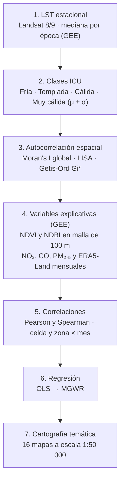

# Islas de calor urbano superficial en Ciudad de Guatemala

**Caracterización de islas de calor superficial en las zonas 1, 4, 9 y 10 de Ciudad de Guatemala mediante teledetección satelital: relación con la cobertura vegetal (NDVI) y la contaminación atmosférica, 2024–2025.**

Repositorio de scripts y resultados de la práctica profesional de la Licenciatura en Ingeniería Ambiental con Énfasis en Gestión, Universidad Rafael Landívar, realizada en el Centro de Estudios en Informática Aplicada (CEIA) de la Universidad del Valle de Guatemala.

---

## Contenido

- [Objetivo](#objetivo)
- [Área y período de estudio](#área-y-período-de-estudio)
- [Datos](#datos)
- [Flujo de trabajo](#flujo-de-trabajo)
- [Estructura del repositorio](#estructura-del-repositorio)
- [Requisitos e instalación](#requisitos-e-instalación)
- [Cómo reproducir el análisis](#cómo-reproducir-el-análisis)
- [Resultados principales](#resultados-principales)
- [Limitaciones](#limitaciones)
- [Cómo citar](#cómo-citar)
- [Licencia](#licencia)

---

## Objetivo

Identificar y caracterizar las islas de calor urbano superficial (ICU) en el área central de Ciudad de Guatemala a partir de la temperatura superficial terrestre (LST) derivada de Landsat 8/9, y analizar su relación espacial con la cobertura vegetal (NDVI), la superficie construida (NDBI) y la contaminación atmosférica (NO₂, CO y PM₂.₅).

## Área y período de estudio

| Elemento | Descripción |
|---|---|
| Área | Zonas 1, 4, 9 y 10 del municipio de Guatemala (≈ 15.6 km²) |
| Sistema de referencia | UTM zona 15N, WGS84 (EPSG:32615) |
| Unidad de análisis | Píxel de 30 m (LST) y malla regular de 100 × 100 m (1733 celdas) |
| Período | Enero 2024 – octubre 2025 |
| Épocas | Verano (época seca, enero–abril) e invierno (época lluviosa, mayo–octubre) de 2024 y 2025 |

## Datos

| Variable | Fuente | Resolución | Plataforma |
|---|---|---|---|
| Temperatura superficial (LST) | Landsat 8/9 OLI/TIRS, Colección 2 (USGS), bandas B10 y B11 | 30 m (térmica nativa 100 m) | Google Earth Engine |
| Vapor de agua atmosférico | NCEP/NCAR Reanalysis (`pr_wtr`) | ≈ 2.5° | Google Earth Engine |
| NDVI, NDBI | Sentinel-2 MSI L2A (ESA/Copernicus) | 10–20 m | Google Earth Engine |
| NO₂ troposférico, CO | Sentinel-5P/TROPOMI L3 (ESA/Copernicus) | ≈ 3.5 × 5.5 km | Google Earth Engine |
| PM₂.₅ | MERRA-2 M2T1NXAER (NASA GMAO) | ≈ 50 × 60 km | Google Earth Engine |
| Temperatura del aire, humedad relativa, viento | ERA5-Land mensual (ECMWF/Copernicus) | ≈ 11 km | Google Earth Engine |
| Límites de zonas | Municipalidad de Guatemala | Vectorial | QGIS |

La LST se obtiene con el algoritmo **Split-Window** de Du et al. (2015), que usa las bandas térmicas B10 y B11 (TOA), la emisividad de cada banda estimada con el método del umbral de NDVI (Skoković et al., 2014) a partir de la reflectancia de superficie Nivel-2, y el vapor de agua atmosférico diario de NCEP/NCAR para seleccionar los coeficientes. Las nubes y sombras se enmascaran píxel a píxel con la banda `QA_PIXEL`.

El PM₂.₅ se calcula a partir de los componentes de aerosoles de MERRA-2 con la fórmula estándar
`PM2.5 = DUST2.5 + SS2.5 + BC + 1.4·OC + 1.375·SO4` (Buchard et al., 2016).

## Flujo de trabajo



| Paso del flujo | Script | Qué hace |
|---|---|---|
| 1 y 2 | `gee/01_lst_split_window_icu.js` | Calcula la LST Split-Window por escena, exporta la mediana de cada época y la clasifica en clases ICU (μ ± σ), con el área y el porcentaje de cada clase. |
| 4 | `gee/02_ndvi_ndbi_estacional.js` | Compuestos estacionales de NDVI y NDBI de Sentinel-2 (rasters de los mapas de NDVI). |
| 4 | `gee/03_serie_mensual_zonas.js` | Serie mensual por zona de LST, NDVI, NDBI, NO₂, CO, PM₂.₅ y variables ERA5-Land, con el porcentaje de píxeles válidos. |
| 4 | `gee/04_ndvi_ndbi_malla100m.js` | NDVI y NDBI de Sentinel-2 por época, promediados en cada celda de la malla de 100 m. |
| 5 | `python/05_correlaciones.py` | Matrices de Pearson y Spearman a nivel de celda y de zona × mes, con control de calidad por nubosidad, figuras de dispersión y contexto meteorológico. |
| 6 | `python/06_ols_mgwr.py` | OLS (R², R² ajustado, AICc, VIF, Moran's I de residuos) y MGWR con anchos de banda por AICc y coeficientes locales. |
| 7 | `python/07_mapas_tematicos.py` | Mapas temáticos a escala 1:50 000 con cuadrícula geográfica, ubicación nacional y municipal, leyenda y cuadro técnico. |

El paso 3 (Moran's I global, LISA y Getis-Ord Gi*) se realizó en QGIS sobre la malla de 100 m, con matriz de vecindad Queen estandarizada por filas y 999 permutaciones.

La carpeta `gee/exploratorios/` contiene pruebas y versiones previas (LST monocanal, compuestos RGB de Sentinel-2, NO₂ y aerosoles de Sentinel-5P, serie por escena 2019–2025). No son necesarias para reproducir los resultados.

## Estructura del repositorio

```
islas-calor-guatemala/
├── README.md
├── requirements.txt
├── LICENSE
├── gee/                     Scripts de Google Earth Engine (JavaScript), pasos 01–04
│   └── exploratorios/       Pruebas y versiones previas
├── python/                  Scripts de análisis y cartografía (Python), pasos 05–07
└── resultados/
    ├── tablas/              Correlaciones, diagnósticos OLS y MGWR (CSV/XLSX)
    ├── figuras/             Dispersión, matrices de correlación, series de tiempo
    └── mapas/               16 mapas temáticos en PDF
```

Los rasters y la malla vectorial no se incluyen por su tamaño. Se generan con los scripts de `gee/` y se exportan a Google Drive.

## Requisitos e instalación

- Cuenta de [Google Earth Engine](https://earthengine.google.com/) con un proyecto de Cloud asociado.
- Python 3.10 o superior.

```bash
pip install -r requirements.txt
```

Contenido de `requirements.txt`:

```
geopandas
rasterio
pandas
numpy
scipy
matplotlib
statsmodels
libpysal
esda
mgwr
pyproj
shapely
```

## Cómo reproducir el análisis

1. **Subir los límites a GEE.** Cargar el shapefile de las zonas 1, 4, 9 y 10 como *asset* y reemplazar la ruta en los scripts de `gee/`.
2. **Ejecutar los scripts de GEE** en el Code Editor, en orden (`01` a `04`), y correr cada tarea de exportación en la pestaña *Tasks*. El script `04` necesita la malla de 100 m como *asset*.
3. **Organizar las salidas.** Por defecto, los scripts de Python buscan los datos en la carpeta superior a `python/` (variable `BASE`), con las subcarpetas indicadas al inicio de cada script (por ejemplo, `Clip_Grid/` para la malla y `GEE_ICU/` para las tablas exportadas de GEE).
4. **Ejecutar los scripts de Python** en orden:

```bash
python python/05_correlaciones.py
python python/06_ols_mgwr.py         # MGWR: ≈ 20–30 min
python python/07_mapas_tematicos.py
```

Cada script indica al inicio sus entradas, parámetros y salidas.

## Resultados principales

- **Distribución de las ICU.** Las clases cálida y muy cálida ocupan entre el 12 % y el 18 % del área según la época, concentradas en las zonas 1 y 4. Las zonas más frías se asocian a la vegetación de la zona 10 y a los barrancos.
- **Autocorrelación espacial.** La LST presenta una fuerte agrupación espacial (Moran's I ≈ 0.90, p = 0.001 en las cuatro épocas).
- **Vegetación y superficie construida.** A nivel de celda, la LST se correlaciona negativamente con el NDVI (r = −0.80 a −0.85) y positivamente con el NDBI (r = 0.84 a 0.86) en las cuatro épocas.
- **Regresión.** El OLS explica entre el 71 % y el 77 % de la variación de la LST, pero sus residuos están autocorrelacionados (Moran's I ≈ 0.52–0.57). El MGWR elimina esa autocorrelación y muestra que el efecto del NDBI es prácticamente uniforme en el área, mientras que el del NDVI varía localmente: es negativo en el 94–97 % de las celdas, con una mediana de −5 a −6 °C por unidad de NDVI.
- **Contaminación atmosférica.** El CO, y en algunas épocas el NO₂ y el PM₂.₅, covarían con la LST a escala mensual. Esta relación es estacional y no espacial, debido a la resolución gruesa de los productos atmosféricos.

## Limitaciones

- La resolución nativa de la banda térmica de Landsat es de 100 m; el producto de 30 m es remuestreado.
- La banda B11 de TIRS presenta mayor incertidumbre por luz parásita (*stray light*), lo que afecta a los algoritmos Split-Window.
- En época lluviosa hay pocas escenas despejadas, por lo que los compuestos de invierno están sesgados hacia mayo y octubre.
- Los productos de contaminación atmosférica no resuelven la variación intraurbana entre zonas.
- Dos años de datos permiten describir tendencias, no establecer conclusiones climáticas.
- La significancia estadística a nivel de celda está sobrestimada por la autocorrelación espacial.

## Cómo citar

> Cordón, J. (2026). *Islas de calor urbano superficial en Ciudad de Guatemala: scripts y resultados* [Repositorio de código]. GitHub. https://github.com/USUARIO/islas-calor-guatemala

### Referencias de los métodos

- Anselin, L. (1995). Local indicators of spatial association—LISA. *Geographical Analysis, 27*(2), 93–115.
- Buchard, V., et al. (2016). Evaluation of the surface PM2.5 in version 1 of the NASA MERRA Aerosol Reanalysis over the United States. *Atmospheric Environment, 125*, 100–111.
- Du, C., Ren, H., Qin, Q., Meng, J., y Zhao, S. (2015). A practical split-window algorithm for estimating land surface temperature from Landsat 8 data. *Remote Sensing, 7*(1), 647–665.
- da Silva, A. R., y Fotheringham, A. S. (2016). The multiple testing issue in geographically weighted regression. *Geographical Analysis, 48*(3), 233–247.
- Fotheringham, A. S., Yang, W., y Kang, W. (2017). Multiscale geographically weighted regression (MGWR). *Annals of the American Association of Geographers, 107*(6), 1247–1265.
- Getis, A., y Ord, J. K. (1992). The analysis of spatial association by use of distance statistics. *Geographical Analysis, 24*(3), 189–206.
- Skoković, D., Sobrino, J. A., Jiménez-Muñoz, J. C., Sòria, G., Julien, Y., Mattar, C., y Cristóbal, J. (2014). Calibration and validation of land surface temperature for Landsat 8-TIRS sensor. *Land Product Validation and Evolution*, ESA/ESRIN.

## Licencia

Código distribuido bajo la licencia MIT. Los datos satelitales están sujetos a las condiciones de uso de sus proveedores (USGS, ESA/Copernicus, NASA y ECMWF).
